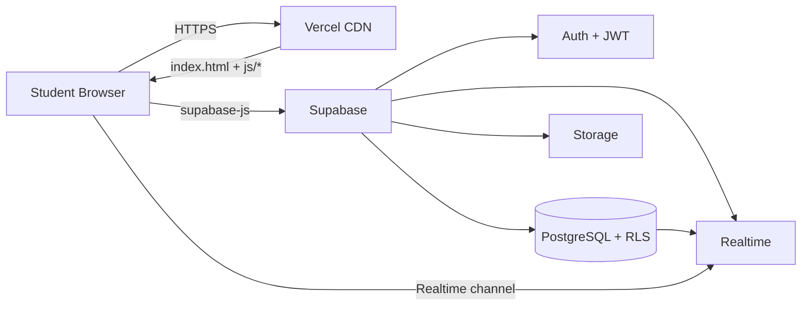
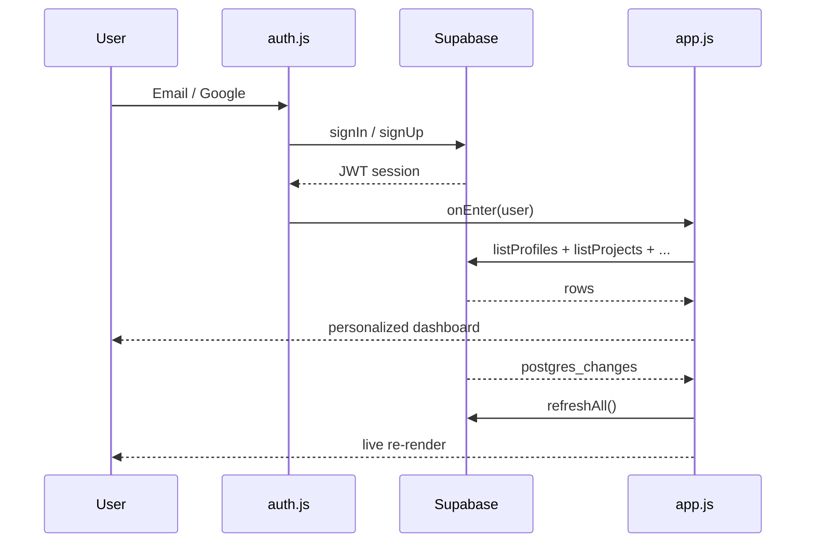
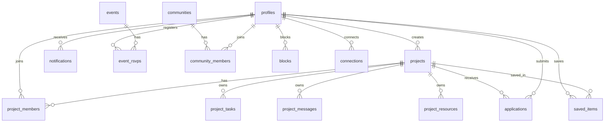

# CollabU — Production Migration Blueprint

**From:** a single-file LocalStorage prototype
**To:** a multi-user, database-backed, real-time PWA on Supabase + static hosting

This repository contains a complete, runnable migration of the original
`collabu_where_student_ideas_meet_real_teams.html` prototype. The original file is
kept untouched for reference; the production app lives in `index.html` plus the
`js/` modules and the `supabase/` SQL.

---

## 1. Tech Stack Summary

| Layer | Choice | Why |
| --- | --- | --- |
| Database | **Supabase PostgreSQL** | Relational integrity for projects/teams/applications; free tier; row-level security. |
| Auth | **Supabase Auth** | Email/password + Google OAuth out of the box; JWT sessions; `auth.users` trigger creates profiles. |
| Realtime | **Supabase Realtime** | Postgres change streams for chat, tasks, applications, notifications without a custom WebSocket server. |
| Storage | **Supabase Storage** | Public buckets for avatars and project images, with user-scoped write policies. |
| Frontend | **Vanilla ES + Tailwind (CDN)** | Preserves the existing lime/charcoal design and the no-build workflow; modules keep it maintainable. |
| Hosting | **Vercel (static) + Supabase** | Zero-cost, global CDN, automatic HTTPS, preview deploys. |
| PWA | **Manifest + Service Worker** | Installable, offline app-shell caching, Supabase traffic always network-first. |

### Why Supabase over Firebase/Appwrite

- **Relational model:** teammates, applications, memberships, and tasks are naturally
  many-to-many. Postgres joins + foreign keys enforce this; a document store would
  duplicate data and require denormalization.
- **RLS:** authorization lives next to the data, so private workspace content cannot
  leak even if a client query is wrong.
- **Realtime on tables:** chat and task updates need no extra service.
- **Free tier:** 500 MB DB, 1 GB storage, 50k MAU, 2 GB bandwidth — ample for a
  student pilot.

Firebase or Appwrite are acceptable substitutes, but the SQL schema and RLS policies
in `supabase/schema.sql` would need to be re-expressed as Firestore rules or Appwrite
permissions.

---

## 2. Architecture



### Request lifecycle

1. `js/supabase.js` creates one `supabase-js` client.
2. `js/auth.js` restores the session and shows a full-screen gate until authenticated.
3. `js/app.js` hydrates a read-through `state` cache from `js/api.js`.
4. Mutations call `window.API.*`, update the cache, then re-render.
5. `js/realtime.js` subscribes once and debounces a refresh when any table changes.



---

## 3. Project Blueprint

```
project/
├── index.html                  # Production entry: original markup + external modules
├── manifest.webmanifest        # PWA manifest (lime theme, standalone)
├── sw.js                       # Service worker: app-shell cache, Supabase bypass
├── vercel.json                 # Static hosting + security headers
├── .env.example                # Env reference (browser reads js/config.js)
├── README.md                   # This blueprint
├── assets/
│   ├── icon.svg                # App icon (any)
│   └── icon-maskable.svg       # Maskable icon
├── js/
│   ├── config.js               # Supabase URL + anon key (edit this)
│   ├── supabase.js             # Creates window.sb
│   ├── api.js                  # All data access (profiles, projects, chat, ...)
│   ├── auth.js                 # Auth gate, email + Google, sign-out
│   ├── realtime.js             # One channel, all table changes
│   └── app.js                  # State, renderers, async mutations, routing
├── supabase/
│   ├── schema.sql              # Tables, indexes, RLS, triggers, storage, realtime
│   ├── seed.sql                # Intentionally empty
└── collabu_where_student_ideas_meet_real_teams.html  # Original prototype (untouched)
```

### Why this shape

- **One API surface** (`js/api.js`) means the UI never embeds SQL and the backend can
  be swapped or cached without touching renderers.
- **Global function declarations** in `app.js` keep the existing inline `onclick`
  handlers working without rewriting every button in the 700-line markup.
- **Classic scripts (no bundler)** preserve the original zero-build deployment.

---

## 4. Database Schema

All DDL is in [`supabase/schema.sql`](supabase/schema.sql) and is idempotent.

### Tables

| Table | Purpose | Key columns |
| --- | --- | --- |
| `profiles` | 1:1 with `auth.users` | `id`, `name`, `college`, `department`, `semester`, `skills[]`, `interests[]`, `bio`, `avatar_url`, `allow_cross_college`, `show_edu_public` |
| `projects` | Ideas / listings | `id`, `title`, `tagline`, `description`, `category`, `type`, `college`, `cross_college`, `creator_id`, `skills[]`, `needed_roles[]`, `team_size`, `image_url`, `featured`, `completed` |
| `project_members` | Team roster | `project_id`, `user_id`, `role` (PK project+user) |
| `project_tasks` | Workspace tasks | `id`, `project_id`, `title`, `assignee_id`, `status` (`To Do`/`In Progress`/`Done`) |
| `project_messages` | Workspace chat | `id`, `project_id`, `sender_id`, `text`, `created_at` |
| `project_resources` | Shared links | `id`, `project_id`, `title`, `url`, `added_by` |
| `applications` | Join requests | `id`, `project_id`, `applicant_id`, `role`, `pitch`, `status` (`Pending`/`Accepted`/`Rejected`) |
| `saved_items` | Saved opportunities | `user_id`, `project_id` |
| `notifications` | Per-user notifications | `id`, `user_id`, `text`, `read` |
| `events` | Hackathons/workshops | `id`, `title`, `event_date`, `mode`, `organizer_id`, `tag`, `description` |
| `event_rsvps` | Registrations | `event_id`, `user_id` |
| `communities` | Public spaces | `id`, `name`, `focus`, `member_count` |
| `community_members` | Community roster | `community_id`, `user_id` |
| `blocks` | Blocked users | `blocker_id`, `blocked_id` |
| `connections` | Teammate requests | `id`, `from_user`, `to_user`, `status` |

### Relationships



### Triggers

- `on_auth_user_created` — creates a `profiles` row (name/college from signup metadata)
  and a welcome notification for every new auth user.
- `trg_add_creator_as_member` — creator is automatically added to `project_members`,
  a kickoff task is created, and a system message is posted when a project is created.
- `trg_profiles_updated`, `trg_projects_updated` — maintain `updated_at`.
- `trg_community_count` — keeps `communities.member_count` accurate.

### Helper RPC

- `notify_user(target_user, body)` — `SECURITY DEFINER` insert into `notifications`.
  Needed because RLS only allows users to write their own notifications, while an
  applicant must notify a project creator (and vice versa).

---

## 5. Row Level Security

RLS is enabled on **every** table. Summary:

| Data | Read | Write |
| --- | --- | --- |
| `profiles` | Any authenticated user | Own row only |
| `projects` | Any authenticated user | Creator only |
| `project_members` | Any authenticated user (needed for counts) | Creator adds; accepted applicant self-adds |
| `project_tasks` / `messages` / `resources` | Project members + creator | Same |
| `applications` | Applicant or project creator | Applicant creates; creator updates status |
| `saved_items`, `notifications`, `blocks` | Owner only | Owner only |
| `events` | Any authenticated user | Organizer |
| `event_rsvps` | Any authenticated user | Own RSVP |
| `communities` / `community_members` | Any authenticated user | Own membership |
| `connections` | From/to user | From user |

Workspace content is protected by the `is_project_collaborator()` helper, so a student
who is not a member cannot read chat, tasks, or resources even with a crafted query.

---

## 6. Setup Guide

### 6.1 Create the Supabase project

1. Create a free project at <https://supabase.com>.
2. Open **Project Settings → API** and copy:
   - `Project URL`
   - `anon public` key

### 6.2 Apply the schema

1. Open **SQL Editor → New query**.
2. Paste the entire contents of `supabase/schema.sql` and run it.
3. Seed data is intentionally empty — the database starts clean.
4. Create your account through the app. The database starts clean — no demo users
   or sample projects are inserted.

### 6.3 Configure authentication

1. **Authentication → Providers → Email**: enable (default).
2. **Authentication → URL Configuration**:
   - **Site URL**: `http://localhost:3000` for local dev.
   - **Redirect URLs**: add `http://localhost:3000/**` and your production URL
     (e.g. `https://collabu.vercel.app/**`).
3. **Google OAuth** (free — recommended):
   - Google Cloud Console → create/select a project.
   - **APIs & Services → OAuth consent screen** → External → app name, support
     email → scopes `email`, `profile`, `openid` → add test users. No billing is
     required for these scopes.
   - **Credentials → Create OAuth client ID → Web application**.
   - **Authorized redirect URI**:
     `https://ffxgsnwbraangtxxukgt.supabase.co/auth/v1/callback`
     (for another project: `https://<PROJECT-REF>.supabase.co/auth/v1/callback`).
   - Copy Client ID + Secret into Supabase **Authentication → Providers → Google**
     and enable the provider.
   - The app's "Continue with Google" button already calls `signInWithOAuth` and
     handles OAuth errors and redirects.
   - For public signups, publish the OAuth consent screen (Testing mode allows 100
     test users). The `email`/`profile`/`openid` scopes do not require Google
     verification.
4. **GitHub OAuth** (for the Streak Challenge):
   - https://github.com/settings/developers → **New OAuth app**.
   - **Authorization callback URL**:
     `https://ffxgsnwbraangtxxukgt.supabase.co/auth/v1/callback`.
   - Copy Client ID + Secret into Supabase **Authentication → Providers → GitHub**.
   - Enable the provider.

### 6.4 Configure the frontend

Open `js/config.js` and replace:

```js
SUPABASE_URL: "https://YOUR-PROJECT-REF.supabase.co",
SUPABASE_ANON_KEY: "YOUR-ANON-PUBLIC-KEY",
```

The anon key is safe in the browser — **RLS is the security boundary**. Never put the
`service_role` key in `js/config.js` or any client file.

### 6.5 Storage (avatars & project images)

`schema.sql` creates two public buckets and user-scoped write policies:

- `avatars`
- `project-images`

Upload path convention: `${auth.uid()}/filename`. The policy requires the first folder
segment to equal the user's UUID, so users can only write inside their own folder.

### 6.6 Run locally

Any static server works:

```powershell
# Option A — Node
npx serve .

# Option B — Python
python -m http.server 3000
```

Open the printed URL, sign up, complete your profile, and post an idea. Open the same
URL in a second browser/incognito and sign up with another account to see real-time
collaboration (chat, tasks, applications, notifications).

> Do **not** open `index.html` via `file://`. Supabase Auth and the service worker
> require `http(s)`.

---

## 7. Implementation Map

### 7.1 Authentication flow — `js/auth.js`

- `Auth.init({ onEnter, onExit })` subscribes to `onAuthStateChange` and restores the
  session.
- `enterApp(user)` removes the `auth-locked` body class and calls `app.js:start()`.
- `exitApp()` re-locks the app and calls `app.js:stop()`.
- Flows: **login**, **signup** (name/college/email/password/confirm + terms),
  **forgot password**, **password recovery**, and **resend confirmation**.
- Signup enforces ≥8 characters with a number or symbol, matching passwords, a
  valid email, and accepted guidelines; a live strength meter and show/hide toggle
  are included.
- `signUp` passes `options.data` (`name`, `college`) so the `handle_new_user` trigger
  can seed the profile, and `emailRedirectTo` so confirmation links return to the app.
- `signInWithOAuth({ provider: "google" })` redirects to Google; OAuth errors are
  captured in `supabase.js` before the SDK consumes the URL and shown in the gate.
- `PASSWORD_RECOVERY` is handled via the `type=recovery` URL flag and the
  `PASSWORD_RECOVERY` auth event, so a recovery link opens the reset form instead of
  the app.
- `signOutApp()` calls `Auth.signOut()`.

### 7.2 Protected routes — `js/app.js`

- `navigateTo(view)` returns to `Auth.show()` if `Auth.isAuthenticated()` is false.
- `parseHash()` whitelists views; unknown hashes fall back to `dashboard`.
- After login, `start()` navigates to `parseHash()` (so deep links survive auth) and
  then `ensureProfile()` redirects incomplete profiles to the dashboard.
- `popstate` re-renders on browser back/forward.

### 7.3 API / client layer — `js/api.js`

Every query is wrapped and throws on error. Key functions:

| Area | Functions |
| --- | --- |
| Profiles | `getProfile`, `ensureProfile`, `listProfiles`, `updateProfile`, `uploadAvatar` |
| Projects | `listProjects`, `createProject`, `updateProject`, `deleteProject` |
| Collaboration | `createTask`, `updateTaskStatus`, `sendMessage`, `createResource` |
| Applications | `createApplication`, `listMyApplications`, `reviewApplication` |
| Saved/blocks | `listSavedIds`, `setSaved`, `listBlockedIds`, `blockUser` |
| Notifications | `listNotifications`, `markAllNotificationsRead`, `pushNotification` |
| Events | `listEvents`, `createEvent`, `setRsvp` |
| Communities | `listCommunities`, `setCommunityMembership` |
| Connections | `connect` |

`listProjects()` fans out six queries in parallel and shapes rows into the exact
structure the original UI expects (`members` as names, `tasks[].assignee` as a name,
`messages[].time` as a relative string, `pendingRequests` from applications).

### 7.4 Realtime — `js/realtime.js` + `js/app.js`

- One channel subscribes to `projects`, `project_members`, `project_tasks`,
  `project_messages`, `project_resources`, `applications`, `notifications`,
  `event_rsvps`, `events`, `connections`, `communities`, `community_members`.
- `scheduleRefresh()` debounces 300 ms and calls `refreshAll()`.
- `refreshAll()` re-hydrates `state` and re-renders the active view.
- Workspace inputs are preserved across re-renders, and dashboard fields are not
  overwritten while focused, so live updates do not erase typing.

### 7.5 LocalStorage removal

| Prototype function | Production replacement |
| --- | --- |
| `loadState()` / `saveState()` | `loadData()` / `refreshAll()` + `API.*` mutations |
| `state.projects` | `API.listProjects()` → PostgreSQL `projects` + joins |
| `state.students` | `API.listProfiles()` (excluding self + blocked) |
| `state.savedIds` | `saved_items` table |
| `state.applications` | `applications` table |
| `state.notifications` | `notifications` table + realtime |
| `toggleSaveProject` | `API.setSaved()` |
| `sendWorkspaceMessage` | `API.sendMessage()` |
| `addWorkspaceTask` / `cycleTaskStatus` | `API.createTask()` / `updateTaskStatus()` |
| `handleJoinRequest` | `API.reviewApplication()` (adds member + notifies) |
| `submitApplication` | `API.createApplication()` (+ notifies creator) |
| `submitNewIdea` | `API.createProject()` (trigger adds creator + kickoff task) |
| `toggleEventRSVP` | `API.setRsvp()` |
| `saveUserProfile` | `API.updateProfile()` |

### 7.6 Loading / empty / error states

- `ensureLoader()` + `showLoader()` — full-screen spinner during hydration.
- Every list renderer has an explicit empty state (marketplace, teammates, workspaces,
  events, showcase, applications, saved).
- `toastError()` surfaces API/RLS errors with the Postgres message.
- Duplicate-application (`23505`) and duplicate-save/connection are handled gracefully.

---

### 7.7 Profiles, privacy & avatars

- `profiles` stores name, initials, college, department, semester, role, availability,
  `skills[]`, `interests[]`, achievements, bio, `avatar_url`, and two privacy flags.
- `API.uploadAvatar()` uploads to the `avatars` bucket at `${auth.uid()}/...` and
  returns the public URL. `handleAvatarChange()` wires the dashboard file input and
  validates type and size (2 MB max).
- `show_edu_public = false` hides college/semester in teammate cards and profile modals.
- `allow_cross_college` is stored as a matching preference.

---

### 7.8 Connections & Web Push

- `connections` powers incoming/outgoing teammate requests. The dashboard shows
  pending requests with **Accept/Decline**, and the list syncs through Realtime.
- `push_subscriptions` + `push_config` + the `send-push` Edge Function deliver
  **Web Push** notifications even when the app is closed. `notify_user()` returns
  the notification ID and `js/push.js` invokes the function after creating one.
- The notification dropdown is responsive (`fixed` full-width on mobile, anchored
  on desktop), and the dashboard has a full notifications + connections view.
- Join requests update optimistically in the creator's workspace, and a newly
  accepted member sees a "You were added to …" toast after the realtime refresh.

### 7.9 GitHub Team Streak Challenge

- Users connect GitHub through Supabase's GitHub OAuth provider. The access token is
  stored server-side in `github_connections`; clients can read only non-secret columns.
  A **Personal Access Token** fallback is available in the UI for users who prefer
  not to create a GitHub OAuth app.
- Teams form around a shared `owner/repo`; teammates join with an 8-character code.
- **Quorum rule (no all-or-nothing):** the streak grows when at least **60%** of
  eligible members push or open a PR that UTC day.
- **Streak Saves:** 3 per team. A missed quorum consumes one save; at zero saves the
  challenge ends and the final streak is preserved.
- **Valid activity:** a commit to the shared repo's default branch or a PR created in
  that repo, via GitHub GraphQL `contributionsCollection`.
- **New members:** eligible the day after joining (24h+ grace).
- **Schedule:** evaluation at **00:10 UTC**, reminder at **20:00 UTC** via `pg_cron`
  → Edge Functions (`streak-evaluate`, `streak-remind`).
- **Delivery:** results and reminders go through the existing notifications + Web Push.
- **GitHub OAuth setup:**
  - https://github.com/settings/developers → **New OAuth app**.
  - Authorization callback URL:
    `https://ffxgsnwbraangtxxukgt.supabase.co/auth/v1/callback`
  - Supabase → **Authentication → Providers → GitHub** → paste Client ID + Secret.

---

### 7.10 Free AI features

- **Providers:** Puter.js (free, no API key, GPT-4o-mini) with a Pollinations.ai fallback and local rule-based fallbacks.
- **Caching:** responses are cached in `ai_cache`, keyed by the SHA-256 of the prompt.
- **Rate limit:** 15 seconds per user; the local fallback is used while cooling down.
- **Features:**
  - **AI Pitch Coach** in the apply modal.
  - **AI Idea Check** in the post-idea modal.
  - **AI Standup Summary** in the workspace chat.
  - **AI Project Summary** in the project modal.
- Puter may ask the user to sign in with a free Puter account on first use. If AI is unavailable, the local fallback still returns useful suggestions.

---

## 8. Deployment Strategy (Zero Cost)

### 8.1 Push to GitHub

```powershell
git init
git add .
git commit -m "CollabU production migration"
git branch -M main
git remote add origin https://github.com/<you>/collabu.git
git push -u origin main
```

### 8.2 Deploy to Vercel

1. <https://vercel.com/new> → **Import Git Repository** → select the repo.
2. Framework preset: **Other**.
3. Build command: **leave empty**. Output directory: **`.`**.
4. Deploy. Vercel serves the static files with HTTPS and a global CDN.
5. Add your production domain to Supabase **Authentication → URL Configuration**
   (Site URL + Redirect URLs).

`vercel.json` sets `cleanUrls`, disables trailing slashes, and adds security headers.
`sw.js` is served with `Cache-Control: no-cache` so PWA updates roll out immediately.

> PWA icons are SVG for zero-build simplicity. Chrome/Edge install from them
> directly; for iOS home-screen icons, add 192/512 PNGs and an
> `<link rel="apple-touch-icon">` tag.

### 8.3 Cost profile

- Supabase Free: 500 MB Postgres, 1 GB storage, 50k MAU, 2 GB egress.
- Vercel Hobby: 100 GB bandwidth, unlimited static requests.
- Total: **$0** for a student pilot. Upgrade only when you exceed free limits.
- Note: Supabase free projects pause after 7 days of inactivity; opening the
  project dashboard restores it. Keep this in mind for a demo or a semester project.

---

## 9. Security Checklist

- [x] RLS enabled on all 15 tables.
- [x] Workspace reads require membership (`is_project_collaborator`).
- [x] Only creators can edit/delete projects; only applicants/creators see applications.
- [x] Notifications/saved/blocks are owner-scoped.
- [x] Cross-user notifications go through `notify_user()` (SECURITY DEFINER), never
      direct inserts.
- [x] Storage writes are scoped to `${auth.uid()}/...`.
- [x] Anon key only in the browser; `service_role` never shipped.
- [x] Security headers + `nosniff` + frame protection in `vercel.json`.
- [x] Supabase traffic bypasses the service worker (no stale auth/data).

---

## 10. Troubleshooting

| Symptom | Fix |
| --- | --- |
| `Invalid login credentials` | Confirm the email (Supabase → Authentication → Users). |
| `new row violates row-level security policy` | Check the JWT `sub` matches `auth.uid()` and the policy for that table. |
| Realtime not updating | Confirm the table is in `supabase_realtime` publication and RLS allows the subscriber to read it. |
| `SUPABASE_URL is not configured` warning | Edit `js/config.js` with the real URL/key. |
| Images broken | Upload to `project-images/${uid}/...` and store the public URL in `projects.image_url`. |
| Service worker serves stale JS | Bump `VERSION` in `sw.js` and redeploy. |
| Google sign-in returns to a blank page | Add the exact production URL to Supabase Redirect URLs. |

---

## 11. Roadmap / Next Steps

1. **Targeted realtime updates** — patch only the affected list instead of
   `refreshAll()` to scale past hundreds of concurrent users.
2. **Uploads** — wire the profile avatar and project cover to Supabase Storage with
   progress + image resizing.
3. **Search & discovery** — add `pg_trgm` indexes and a Postgres full-text `search`
   column; server-side pagination.
4. **Moderation** — add `reports` and `moderation_actions` tables with an admin role.
5. **Messaging** — add typing indicators via Realtime Broadcast, read receipts, and
   attachments.
6. **Testing** — Vitest for `api.js`, Playwright for the signup → post → apply → chat
   flow.
7. **CI/CD** — GitHub Actions running `node --check`, SQL linting, and Playwright on
   preview deploys.
8. **Typed frontend** — migrate `js/` to Vite + TypeScript while keeping the same CSS
   and markup.
9. **Email/push notifications** — Supabase Edge Functions + Resend/Web Push.
10. **Analytics** — privacy-friendly product metrics on top of the existing tables.

---

## 12. File-by-File Quick Reference

| File | Responsibility |
| --- | --- |
| `index.html` | Original markup + Tailwind config + external module tags + early `auth-locked` class. |
| `js/config.js` | Supabase URL, anon key, Google redirect. **Edit this first.** |
| `js/supabase.js` | Creates the singleton client (`window.sb`). |
| `js/api.js` | Every database call; shapes rows for the UI. |
| `js/auth.js` | Auth gate: login, signup, forgot password, recovery, resend, Google OAuth, session restore, sign-out. |
| `js/realtime.js` | Single Supabase channel fanning out table changes. |
| `js/app.js` | State cache, renderers, async mutations, hash routing, PWA registration. |
| `supabase/schema.sql` | Tables, indexes, RLS, triggers, RPC, storage, realtime publication. |
| `supabase/seed.sql` | Intentionally empty; the database starts clean. |
| `sw.js` | Offline app shell; never caches Supabase. |
| `manifest.webmanifest` | Installable PWA metadata. |
| `vercel.json` | Static hosting + headers. |
| `collabu_where_student_ideas_meet_real_teams.html` | Original LocalStorage prototype, kept untouched for reference. |